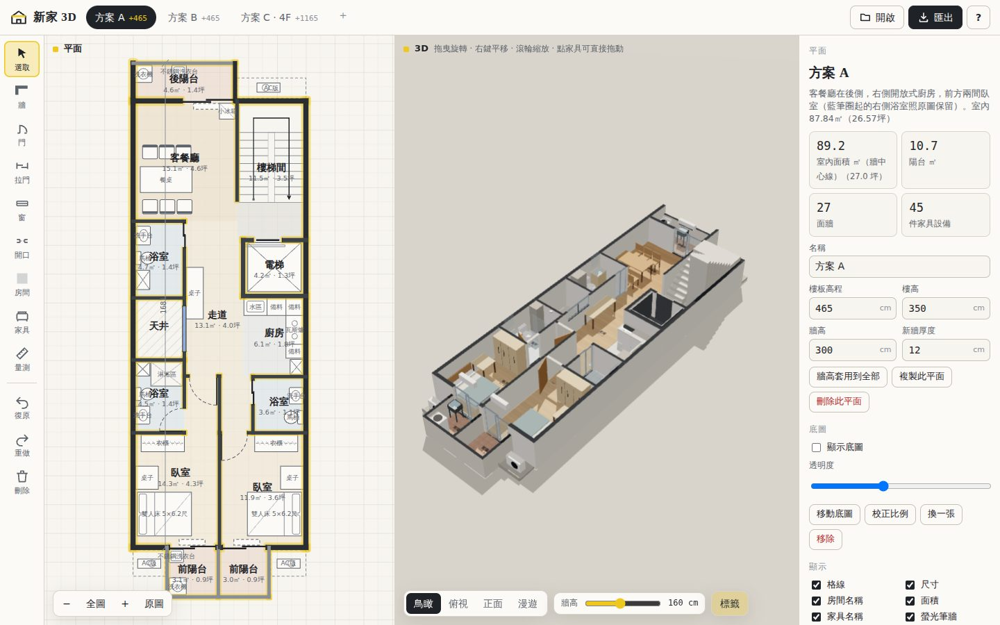

# 新家 3D 平面

把 CAD 平面圖變成可以旋轉、走進去看的 3D 模型；可以直接拖拉修改，也能匯出 DXF 回 AutoCAD。
純網頁、不用安裝，手機和電腦都能用。



## 開啟方式

這個資料夾是靜態網站，任何靜態主機都能放：

- **GitHub Pages**：在 repo 的 Settings → Pages 開啟後，網址是 `https://<帳號>.github.io/WebAR/house3d/`
- **本機**：在 `house3d` 資料夾執行 `npx http-server -c-1 .`（或 `python3 -m http.server`），再開瀏覽器到顯示的網址。
  （直接雙擊 `index.html` 不行，瀏覽器不允許用 `file://` 載入模組。）

## 內建的三個方案

依照媽媽的 A3 列印圖（比例 1/100）手工轉錄，按左下角「原圖」可把掃描圖疊在下面對照。

| 方案 | 樓板高程 | 內容 |
|---|---|---|
| 方案 A | +465 | 後側客餐廳、右側開放式廚房、前方兩間臥室 |
| 方案 B | +465 | 後側廚房＋餐桌、中段客廳、右側儲藏室、前方兩間臥室 |
| 方案 C · 4F | +1165 | 後側臥室、中段客廳＋餐廳、右前方廚房、左前臥室 |

座標原點是左外牆中心線與後牆中心線的交點，單位公分；主要尺寸取自圖上標註（縱向格線 337.5 / 80 / 266.5 / 215 / 266.5 / 384.5，共 1550；橫向 300 + 300）。

圖上沒有標、由我推定的地方（都可以在編輯器裡改）：

- 牆厚：外牆 18 cm、隔間牆 12 cm；牆高 300 cm、樓高 350 cm（由樓梯 19 階 × 18.42 cm 推得）。
- 門高 210 cm、推拉門 220 cm、窗台 90 cm；陽台女兒牆 110 cm。
- 天井與走道之間的牆畫成一扇窗（圖上是細線）。
- 方案 B 的儲藏室圖上沒有畫門，先放一扇 80 cm 的門。
- 方案 C 廚房上方的「片牆」先開一個 90 cm 的開口，否則廚房進不去。
- 方案 A 右側浴室有藍筆圈起來，照原圖保留。

## 怎麼用

- **3D**：拖曳旋轉、右鍵平移、滾輪縮放。「牆高」滑桿可以把牆剖低看室內（預設 160 cm 娃娃屋視角，拉到最右是完整牆高）。「漫遊」是第一人稱，用 W A S D / 方向鍵或畫面上的按鈕走動。
- **拖拉修改**：
  - 拖牆身 → 平行移動，相連的牆自動伸縮，房間範圍跟著變；拖牆的端點 → 改長度或角度。雙擊牆可以在該點分割。
  - 拖門窗 → 沿著牆滑動，拖到別面牆上會換牆。
  - 拖家具 → 移動（靠近牆會自動貼齊）；藍色圓點旋轉、方形點調整尺寸。3D 裡也可以直接拖家具。
  - 右側面板可以輸入精確數字。
- **畫新東西**：左側工具列有牆、門、推拉門、窗、開口、房間、家具、量測。「房間」工具點在牆圍起來的區域內會自動偵測範圍並計算坪數。
- **快捷鍵**：`V` 選取、`W` 牆、`D` 門、`N` 窗、`F` 家具、`M` 量測、`R` 旋轉家具、`Delete` 刪除、`Ctrl+Z` 復原、`Ctrl+Shift+Z` 重做、`Ctrl+D` 複製、方向鍵微調（加 Shift 一次 10 cm）。
- 所有修改都自動存在這台裝置的瀏覽器裡。「?」裡可以還原成原始三個方案。

## 丟檔案進來

把檔案拖進視窗，或按「開啟」：

| 檔案 | 會發生什麼 |
|---|---|
| **DXF**（AutoCAD：另存新檔 → AutoCAD DXF） | 自動辨識牆（8–45 cm 的平行雙線）、門（門弧）、窗與推拉門、房間（封閉區域＋房名文字）、家具圖塊與樓梯，直接產生 3D。支援 mm / cm / m，會讀 `$INSUNITS`，沒有標示時依尺寸推測。 |
| **向量 PDF**（AutoCAD 列印成 PDF） | 試驗性：用線條粗細與形狀辨識牆和門，需要輸入比例（例如 1/100）。沒有圖層資訊，結果通常要手動修整；有 DXF 的話優先用 DXF。 |
| **掃描 PDF、照片、截圖** | 當成底圖放進平面，用「校正比例」點一段已知長度（例如標註 600 的那段）後，就能照著描牆。 |
| **JSON** | 本工具匯出的專案備份。 |
| **DWG** | 瀏覽器無法讀取 AutoCAD 專有格式，請先另存成 DXF。 |

## 匯出

- **DXF**：AutoCAD R12 格式，單位公分，Y 軸朝上。圖層分為 `A-WALL`（牆）、`A-WALL-PRPT`（矮牆）、`A-DOOR`、`A-GLAZ`（窗）、`A-FURN`（家具）、`A-FIXT`（衛浴廚具設備）、`A-STRS`（樓梯）、`A-AREA`（房間範圍）、`A-ANNO-TEXT`、`A-ANNO-DIMS`。牆線帶有高度（thickness），在 AutoCAD 切到 3D 視角會直接立起來。中文字型使用 `txt` + `chineset.shx`。檔案裡另外夾帶一份原始資料（DXF 註解），同一個檔案丟回來可以完整還原；在 AutoCAD 修改存檔後再丟回來，則會重新辨識幾何。
- **GLB**：3D 模型（公尺），可用 Blender、SketchUp（外掛）、Windows 3D 檢視器開啟。
- **PNG**：目前 3D 畫面截圖。
- **JSON**：完整專案備份。

## 程式結構

```
house3d/
├─ index.html          介面
├─ css/app.css         版面與配色（淺色／深色）
├─ js/
│  ├─ app.js           狀態、復原重做、屬性面板、匯入匯出
│  ├─ model.js         資料模型與幾何工具
│  ├─ plans.js         三個內建方案（轉錄資料）
│  ├─ catalog.js       家具目錄
│  ├─ editor2d.js      2D 平面編輯器（SVG）
│  ├─ view3d.js        3D 檢視（Three.js）
│  ├─ geometry.js      房間自動偵測
│  ├─ dxf.js           DXF 匯出與辨識
│  └─ files.js         存檔、ZIP、圖片/PDF 底圖、向量 PDF 擷取
├─ vendor/             three.js r170、pdf.js 4.10（含中文 CMap）
├─ assets/             三張原圖（底圖對照用）
└─ tests/dxf-roundtrip.mjs   `node house3d/tests/dxf-roundtrip.mjs`
```

資料格式（單位公分）：每個平面有 `walls`（中心線 a→b、厚度 t、高度 h）、`openings`（所在牆、距牆起點的中心位置 pos、寬高、窗台、開門鉸鏈與方向）、`rooms`（多邊形）、`items`（家具：中心 x/y、寬 w、深 d、角度 rot）。
